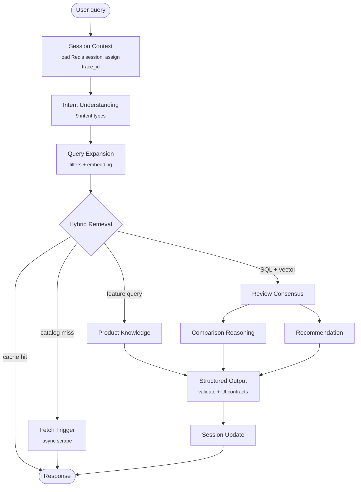

<div align="center">

# Evalio

### AI Product Decision Engine

**Ask a shopping question in plain English. Get a ranked, explained, evidence-backed answer.**
Multi-agent reasoning over a SQL + vector product catalog, with session memory and full pipeline tracing.


</div>

---

## Overview

Evalio is a decision engine for consumer electronics (smartphones first, laptops next). Instead of returning a list of links, it works out what the user actually wants, retrieves candidates from a structured catalog, and produces a recommendation or a head-to-head comparison that explains *why*.

The guiding rule is a hard split of responsibilities:

> **AI reasons. Code retrieves.** LLM agents never fetch, rank by arithmetic, or invent specs. They interpret intent and explain structured data that deterministic code has already retrieved.

## Highlights

- **7 specialised LangGraph agents**, each with a strict Pydantic output schema, a prompt file, and its own tools.
- **Hybrid retrieval**: filter in PostgreSQL first, then vector re-rank the filtered set with pgvector (HNSW). No full-table scans.
- **Session memory** in Redis, so follow-ups like *"what about the cheaper one?"* resolve against earlier products.
- **Cost-aware model routing**: small, fast models for classification and expansion; larger models only for reasoning-heavy nodes.
- **Entity resolution and spec normalisation**: `"s24"` becomes `samsung-galaxy-s24`; scraped specs map onto canonical fields.
- **Non-blocking catalog growth**: unknown products trigger a background Playwright scrape; the user gets a partial answer immediately.
- **Per-request tracing**: every graph node records timing spans, retrievable by `trace_id`.
- **Versioned UI contracts**: four stable component adapters so a frontend never breaks on agent changes.
- **Retry and fallback**: each LLM node retries twice, then degrades to a safe structured fallback.

## Architecture



### Agents

| Agent | Responsibility | Model |
|---|---|---|
| `intent_understanding` | Classify the query into one of 9 intents and extract constraints | gpt-4o-mini |
| `query_expansion` | Rewrite into structured filters and compute the query embedding | gpt-4o-mini |
| `hybrid_retrieval` | Cache, session bypass, entity resolution, SQL to vector join, fetch trigger | no LLM |
| `product_knowledge` | Technical and feature explanations | gpt-4o-mini |
| `review_consensus` | Summarise real-world user feedback | gpt-4o |
| `comparison_reasoning` | Technical diffs and trade-offs between products | gpt-4o |
| `recommendation` | Ranked picks with justification | gpt-4o |

Routing lives in [`backend/app/services/llm_router.py`](backend/app/services/llm_router.py).

### Intents

`SEARCH_PRODUCT` · `COMPARE_PRODUCTS` · `FEATURE_QUERY` · `RECOMMEND_PRODUCTS` · `PRICE_QUERY` · `PRODUCT_DEEP_DIVE` · `TECHNICAL_EXPLANATION` · `FOLLOWUP_QUERY` · `INVALID_QUERY`

### Data layer

| Store | Purpose |
|---|---|
| PostgreSQL + pgvector | products, variants, component scores, embeddings (1536-dim, HNSW), price history, review summaries, search cache |
| Redis | session memory (`session:<id>`), trace spans (`trace:<id>`), fetch locks, Celery broker |

## Tech Stack

| Layer | Tools |
|---|---|
| API | FastAPI, Pydantic v2, structlog |
| Orchestration | LangGraph `StateGraph` with conditional routing |
| LLM | OpenAI (`gpt-4o`, `gpt-4o-mini`), `text-embedding-3-small` |
| Storage | PostgreSQL 16 + pgvector, Redis 7, SQLAlchemy 2 (async), Alembic |
| Workers | Celery, Playwright scrapers (Amazon, Flipkart, 91mobiles, Smartprix) |
| Infra | Docker Compose, Terraform skeleton, GitHub Actions |
| Frontend | Next.js stub |

## Quick Start

**Prerequisites:** Python 3.11+, Docker, an OpenAI API key.

```bash
# 1. Configure
cp .env.example backend/.env       # then set OPENAI_API_KEY

# 2. Start Postgres (pgvector) and Redis
cd infra && docker compose up -d postgres redis && cd ..

# 3. Install and migrate
cd backend
pip install -e ".[dev]"
alembic upgrade head

# 4. Seed the demo catalog (8 smartphones with scores and embeddings)
python scripts/seed_demo.py
```

### Run it

**Interactive terminal (fastest way to try it):**

```bash
cd backend
python -X utf8 -m app.cli
```

Commands inside the CLI: `:trace` (show last pipeline trace), `:session_reset`, `:exit`.

**HTTP API:**

```bash
uvicorn app.main:app --reload
curl http://localhost:8000/health
```

**Optional background scraping worker** (on Windows use `python -m celery`):

```bash
python -m celery -A app.workers.tasks worker --loglevel=info --pool=solo
```

## API

| Method | Endpoint | Description |
|---|---|---|
| `POST` | `/v1/chat` | Unified decision endpoint. Pass `session_id` to continue a conversation |
| `GET` | `/v1/trace/{trace_id}` | Per-node timing spans for a request |
| `POST` | `/v1/search` | Direct product search |
| `POST` | `/v1/compare` | Compare 2 to 4 products |
| `POST` | `/v1/scrape` | Queue a catalog fetch |
| `GET` | `/v1/metrics/cache` · `/v1/metrics/embedding` | Cache and embedding metrics |
| `GET` | `/health` | Liveness |

```bash
curl -X POST http://localhost:8000/v1/chat \
  -H "Content-Type: application/json" \
  -d '{"query": "best camera phone under 30k", "session_id": null}'
```

`structured_output` in the response carries UI-ready, schema-versioned components:
`recommendation_cards` · `comparison_table` · `product_detail` · `review_summary`.

## Project Structure

```
evalio/
├── backend/
│   ├── app/
│   │   ├── graph.py              # LangGraph root graph + GraphState
│   │   ├── main.py               # FastAPI app and lifespan wiring
│   │   ├── cli.py                # Multi-turn terminal client
│   │   ├── agents/               # 7 agents: agent.py, schema.py, prompt.md, tools.py
│   │   ├── api/v1/               # chat, search, compare, scrape, metrics, trace
│   │   ├── services/             # llm_router, entity_resolver, spec_normalizer,
│   │   │                         #   trace_logger, output_generator, response_validator
│   │   ├── tools/                # db, embedding, spec and price tools used by agents
│   │   ├── ui_contracts/         # versioned component adapters
│   │   ├── schemas/              # Pydantic request/response/output models
│   │   ├── models/               # SQLAlchemy tables
│   │   ├── workers/              # Celery tasks and Redis locks
│   │   └── core/                 # config, logging, constants
│   ├── alembic/                  # database migrations
│   └── scripts/seed_demo.py      # demo catalog seeder
├── scraper/                      # Playwright scrapers, normalisation, scoring, discovery
├── frontend/                     # Next.js app (stub)
├── infra/                        # docker-compose, init SQL, Terraform
├── tests/                        # unit, integration
└── .github/workflows/ci.yml
```

## Design Notes

- **SQL first, vectors second.** Hard constraints (budget, brand, RAM) are SQL filters. Embeddings only re-rank the filtered set, so a semantically close but out-of-budget phone can never surface.
- **State-only graph.** Nodes are pure functions over `GraphState`; there is no other mutation channel, which keeps traces and retries predictable.
- **Structured output everywhere.** Agents return validated JSON, never free text; a response validator runs before anything reaches the UI.
- **Fresh state per query.** The CLI and API build a new `GraphState` for every turn so cost and latency never accumulate across questions.
- **Freshness gates.** Price, review and component-score data carry staleness TTLs that decide when a refetch is triggered.

## Testing

```bash
cd backend
pytest ../tests/unit -v
```

Tests written against the earlier deterministic-ranking pipeline are kept under `tests/legacy_v1/` for reference and are excluded from collection.

## Roadmap

- [x] Multi-agent LangGraph pipeline with session memory
- [x] Hybrid SQL + pgvector retrieval
- [x] Entity resolution, spec normalisation, trace observability
- [x] Versioned UI component contracts
- [x] Interactive CLI client
- [ ] Frontend (Next.js) consuming the UI contracts
- [ ] Laptop catalog and scrapers
- [ ] Rebuilt unit and integration suite for the v2 agents
- [ ] Production deploy (Terraform, managed Postgres/Redis)

## License

Proprietary. All rights reserved.
